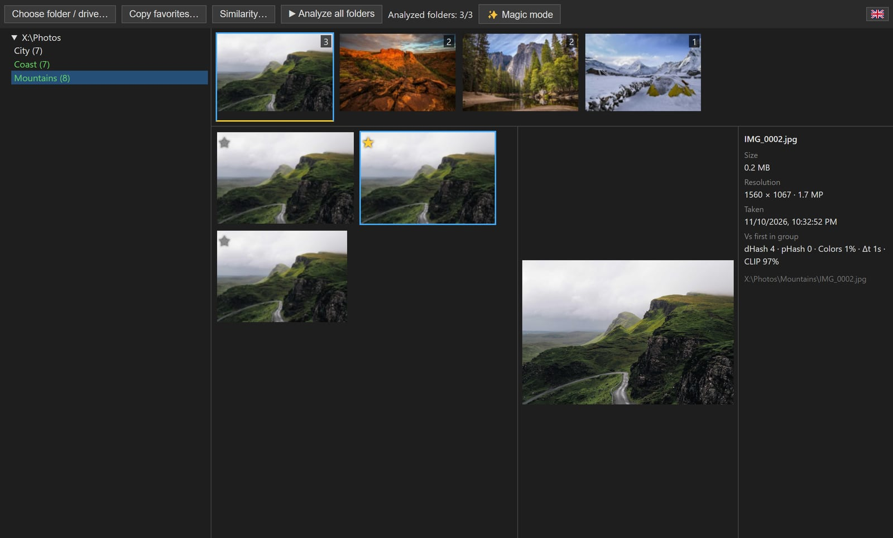

# Twinnow

**Free and open-source** desktop app that finds series of similar photos, lets you star the best shots and copies them out with the folder structure. Windows, macOS and Linux.

- 🔒 **Everything stays on your computer.** Photos are analyzed locally (even the neural network): no uploads, no account, no cloud.
- 🛡️ **Never deletes anything.** Twinnow only reads your photos and copies the ones you picked; originals are never moved, overwritten or deleted.

**🌐 [twinnow.artme.dev](https://twinnow.artme.dev)** · made by [Artem I.](https://artme.dev) · [other tools](https://artme.dev/tools)



## ⬇ Download

| OS | File |
|---|---|
| Windows 10 / 11 (portable) | **[Twinnow.exe](../../releases/download/latest/Twinnow.exe)** |
| macOS (Apple Silicon) | **[Twinnow-mac.dmg](../../releases/download/latest/Twinnow-mac.dmg)** |
| Linux (any distro) | **[Twinnow-linux.AppImage](../../releases/download/latest/Twinnow-linux.AppImage)** |
| Fedora / RHEL / openSUSE | **[Twinnow-linux.rpm](../../releases/download/latest/Twinnow-linux.rpm)** |
| Debian / Ubuntu | **[Twinnow-linux.deb](../../releases/download/latest/Twinnow-linux.deb)** |

Built automatically by GitHub Actions on every push to `main`.

## Features

- Scans a folder or a whole drive and shows folders with photos as a tree.
- Groups similar photos; biggest groups first; saved groups show instantly.
- Similarity methods (any combination, AND / OR, adjustable thresholds):
  dHash, pHash (DCT), color histogram, capture time (EXIF), optional neural network (CLIP, runs locally, downloaded on request).
- Every algorithm's score is saved for every file and shown in the collapsible photo info with EXIF details.
- Favorites (★, double click, Space/F); folders with favorites are marked as processed.
- Magic mode: favorites every unique photo and one random photo of each similar group in all folders.
- Copies favorites preserving folder structure; originals stay untouched.
- Background analysis with ETA; state, feature cache and progress persist between launches.
- UI languages: English, Español, Français, Русский, العربية, 中文.

Keys: ←/→ photo in a group, ↑/↓ group, Space/F favorite.

## Development

```
npm install
npm start      # build UI and run
npm run dist   # build packages for the current OS into release/
```

## License

[MIT](LICENSE)
